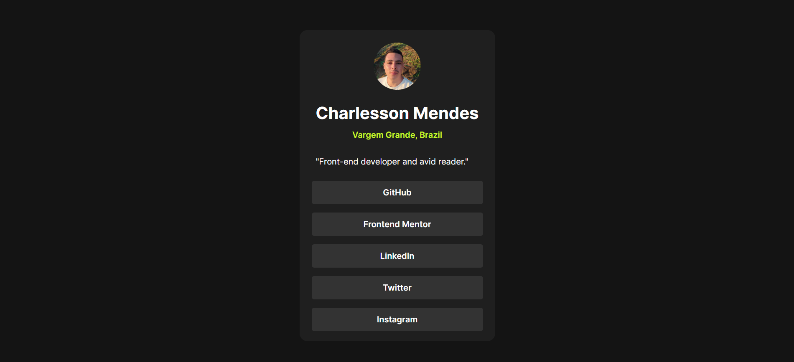

# 🔗 Social Links Profile

## 📖 About the Project

A personal profile card featuring social media links, developed as part of a [Frontend Mentor](https://www.frontendmentor.io/) challenge.

The project presents a simple and responsive interface containing personal information, a profile picture, and links to different social platforms. It was built using HTML5 and CSS3, focusing on layout composition, styling, and responsive design.

## 🎨 Preview

The interface features a dark-themed profile card with a circular profile picture, personal information, and interactive social links highlighted with an accent color.



## ✨ Features

- Personal profile card with a profile picture.
- Display of personal information and location.
- Links to five social media platforms.
- Interactive hover effects on social links.
- Responsive layout for smaller screens.
- Custom typography using locally stored Inter font files.
- CSS variables for centralized color management.

## 🛠️ Technologies Used

- **HTML5** – Semantic page structure and content organization.
- **CSS3** – Styling, layout composition, and responsive design.
- **Flexbox** – Element alignment and layout organization.
- **CSS Custom Properties** – Reusable variables for colors.
- **@font-face** – Local font integration using the Inter typeface.

## 📂 Project Structure

```text
social-links-profile-main/
├── src/
│   ├── css/
│   │   ├── responsive.css
│   │   └── style.css
│   ├── fonts/
│   │   ├── Inter-Bold.ttf
│   │   ├── Inter-Regular.ttf
│   │   ├── Inter-SemiBold.ttf
│   │   └── Inter-VariableFont_slnt,wght.ttf
│   └── images/
│       ├── profile-image.jpg
│       └── favicon-32x32.png
├── index.html
├── LICENSE
└── README.md
```

## 🚀 Getting Started

To run this project locally, follow the instructions below.

### Prerequisites

- A modern web browser.
- Git installed on your machine.

### Installation

1. Clone the repository:

   ```bash
   git clone https://github.com/Charlesson-MP/social-links-profile-main.git
   ```

2. Navigate to the project directory:

   ```bash
   cd social-links-profile-main
   ```

3. Open the `index.html` file in your browser.

No additional dependencies or build tools are required.

## 🔮 Future Improvements

The following improvements may be considered in future updates:

- [ ] Improve accessibility with more descriptive image alternatives and visible keyboard focus states.
- [ ] Add `rel="noopener noreferrer"` to external links opened in new tabs.
- [ ] Simplify the responsive stylesheet and reduce duplicated CSS rules.
- [ ] Review and optimize custom font assets, removing unnecessary files.
- [ ] Improve responsiveness across different screen sizes and viewport heights.
- [ ] Refine the semantic HTML structure where appropriate.

## 📄 License

This project is licensed under the **GNU General Public License v3.0 (GPL-3.0)**. See the [LICENSE](./LICENSE) file for more information.

---

Developed by [Charlesson Mendes](https://github.com/Charlesson-MP).
